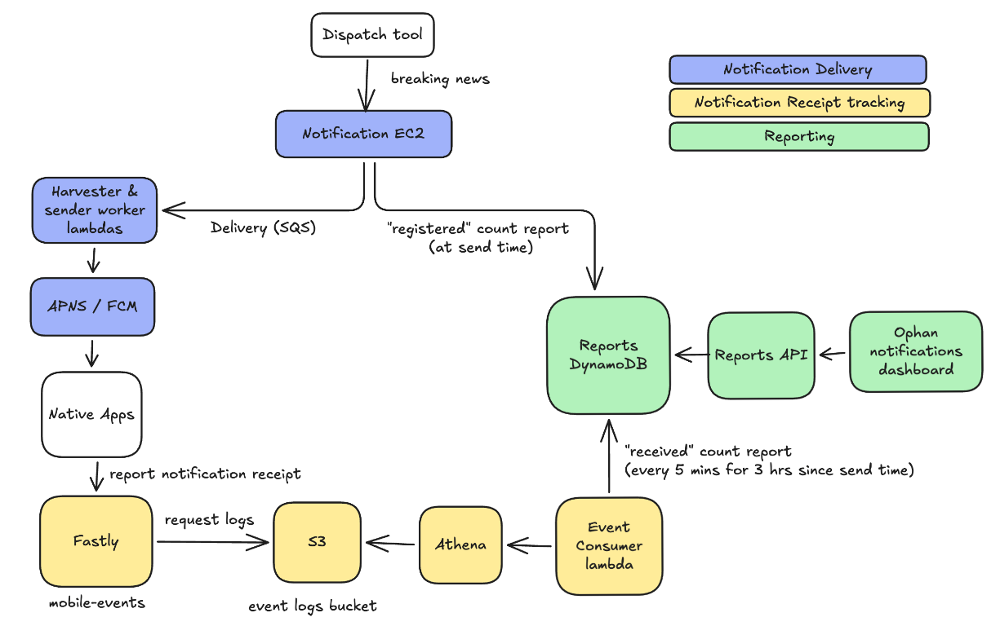
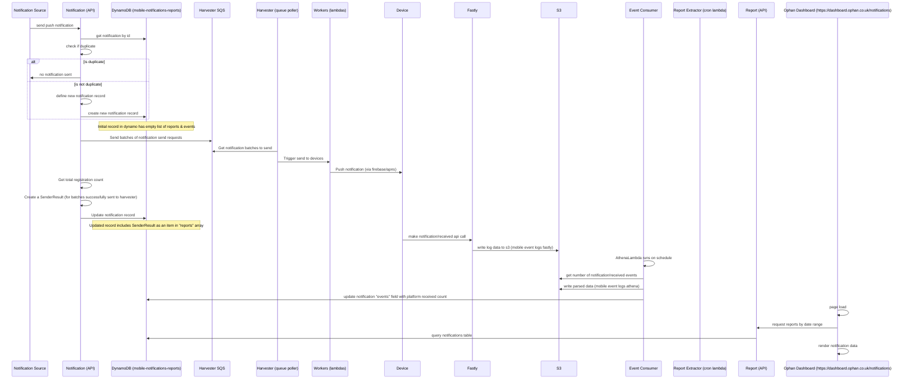

# Reports

The Reports API is used by the Ophan dashboard to show data about when notifications were sent and the number of deliveries per platform.

This overview follows a breaking news notification from send to delivery and explains how the registered and received counts reach the dashboard.

### Delivery

- The dispatch tool sends a breaking news notification to the notification service (EC2).
- The service queues token ranges on SQS. Harvester lambdas fetch the registered device tokens and queue batches for the sender worker lambdas, which send the push through APNs/FCM to the native apps.
- See the [worker descriptions](../README.md#workers) for details of harvesting and sending.

### Registered count (at send time)

- When a notification is sent, the notification service creates its record in the reports DynamoDB table.
- It records the registration count associated with batches successfully queued for harvesting. This is the **registered** count, not confirmation that the devices received the notification.

### Received tracking

- When an app receives the notification, it calls the app receipt endpoint, which is served by Fastly.
- Fastly writes the request logs to an event logs bucket in S3.
- The event consumer lambda runs every five minutes. It queries those logs through Athena and counts receipt events per notification and platform.
- It writes these **received** counts to the reports table, replacing the previous counts rather than incrementing them. By default, scheduled runs only update notifications sent within the last three hours; custom reporting windows are supported.
- Received counts represent app-reported receipt events, not necessarily unique devices, and do not indicate that a user opened or read the notification.

### Reporting

- The Ophan notifications dashboard calls the Reports API, which reads the reports table.
- Each notification shows its registered and received counts side by side.

There is more going on than just what's described in the diagram (specifically around how notification data is ingested into the ophan data lake). However, this diagram should cover the components most relevant to mobile people.

